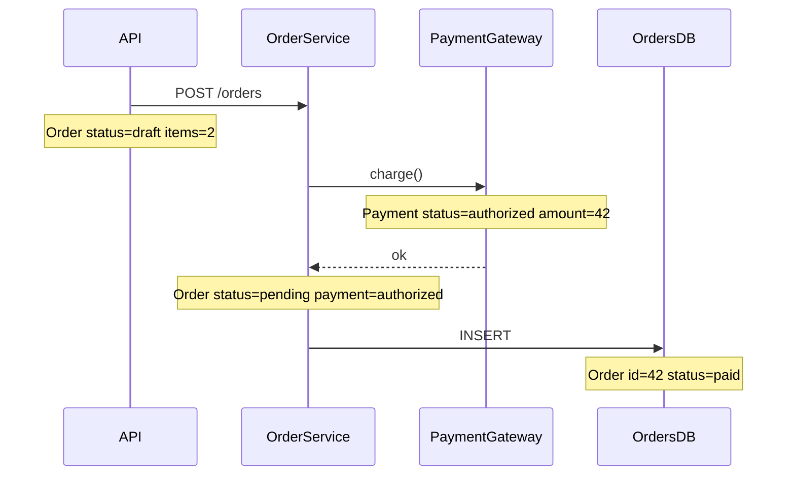

# Plan — Timeline player + "data living through the steps"

## Problem

1. The scenario player is a row of numbered pills, a `‹ ▶ ›` transport and a `n / N` counter
   (`packages/docdive-element/src/element.ts`, `initTrace`/`setStep`/`play`). It works but reads as a form, not as a
   player. Wanted: a timeline you scrub, with a single icon-only ▶/⏸ glyph at its left end; no `‹ ›` buttons.
2. A step is only `from → to: label`. Nothing in the model says what the data looks like at that moment, so the viewer
   cannot show "the order is a draft in the frontend, then pending in the service, then a row in the DB".

## Approach

**Model (zero new syntax).** A Mermaid `Note` placed right after a message carries the state of the participant(s) it
sits over, at that step. It renders on GitHub as a plain note, so docs stay valid without docdive.

````markdown

````

- Convention: `Note (over|left of|right of) A[,B]: [Entity] key=value key=value… [free text]`. The leading PascalCase
  word is the entity; `k=v` tokens are fields; anything else is free text. `<br/>` separates lines.
- A note before the first message is the initial state (step 0). A note after message *k* belongs to step *k*.
- State of participant P at step k = notes over P up to k, merged field by field (later wins). Fields set by the
  note at step k are "changed". An entity ledger groups notes by entity across participants
  (`Order: draft @API → pending @OrderService → paid @OrdersDB`): that is the "living through the process" view.
- `index.json`: `steps[k].notes?: { over: string[]; text: string; entity?: string; fields?: Record<string,string> }[]`.
  Additive, optional → `INDEX_VERSION` stays 1.
- Link to DB / frontend: a note sits *over an element*, and elements already carry `src` and their own doc. The DB
  state is the note over `OrdersDB`, the frontend state the note over `API`/`Browser`; the card links to that
  element (select → inspector → Dive into / Source).

**Viewer.** The rail replaces pills + transport; state renders in four places, all driven by one pure helper set
in `shared.ts`. The lab round decides their final shape and whether all four ship (badges inside the SVG are the
risky one: HTML overlaid on a scaled, horizontally scrollable SVG).

## Lab round (cor-design, `.cor/design-lab`) — DONE, locked: A + B's entity trail as strip mode, no badges

Same data (toy + mock notes above), three directions, each with the inspector "State at this step" section:

- **A — Dotted rail + state strip**: `▶ ●━━●━━◉──○──○  3 / 6`; below, one card per participant holding state
  (frontend / service / DB), changed fields highlighted, free text in muted; badges pinned to active SVG boxes.
- **B — Segmented story bar + entity ledger**: Instagram-style segments (one per step, filled progress, label of the
  hovered segment); below, one row per entity with its field values and a per-step diff marker and the participant
  it currently lives at.
- **C — Swimlane timeline**: rows = participants that hold state, columns = steps, a vertical playhead; cells carry
  the state chips. Timeline and state are one component; scrub by clicking a column or dragging the playhead.

Deliverables: `lab.js`/`lab.css`/`index.html` variants, `shots/`, `scorecard.md` round 2, `decision-log.md`,
`handoff.md` updated. Shared across variants: one icon-only ▶/⏸ toggle (keeps DD-EL-007), ←/→ and drag scrub,
`n / N` kept, `aria-valuetext` = step sentence, reduced motion off, targets ≥ 28px.

## Todos

### Phase 0 — Lab
- `lab-notes-data`: add mock notes to the lab's toy scenario and a `stateAt`/`ledger` helper in `lab.js`
  (candidates for `shared.ts`).
- `lab-variants`: build variants A/B/C (timeline + state surfaces + inspector section), light/dark, 1280/390.
- `lab-score-lock`: shots, scorecard round 2, UX framework cross-check, decision log, handoff. **User gate.**

### Phase 1 — Model
- `seq-notes-parse`: `sequence.ts` parses `Note over|left of|right of A[,B]: text` into `steps[k].notes`
  (step 0 = initial). Entity/fields/free-text split. Unit tests (`extractors.test.ts`).
- `model-notes-index`: `model.ts` `Scenario.steps` carries notes; `Index` type in `shared.ts` mirrors it. Model
  tests / CLI snapshots updated.
- `lint-note-participant`: warning `note-participant-unknown` when a note names a non-participant
  (`lint.ts` + test).
- `fixture-notes`: notes added to `fixtures/toy/scenarios/checkout.md` (drives e2e and the example sites).
- `skill-conventions`: `conventions.md` + `SKILL.md` document the note convention (when to add state, which
  participants, entity naming); `context.ts` includes an element's state notes in its context bundle.

### Phase 2 — Viewer timeline
- `shared-timeline-helpers`: `shared.ts` pure helpers: `stateAt(index, scenario, step)` → per participant
  `{ entity, fields, changed, text }`, `entityLedger(index, scenario, step)`, `stepTitle` for `aria-valuetext`;
  tests in `shared.test.ts`.
- `element-rail`: replace `pills` + `transport` with the locked rail: `data-docdive-scrub` slider
  (`role=slider`/native range, ←/→, drag, click a `data-docdive-mark`), single `data-docdive-play`/`data-docdive-pause`
  glyph, `data-docdive-step` counter kept, `data-docdive-prev/next` removed. CSS tokens only (DD-EL-008).
- `e2e-rail`: `e2e/trace.pw.ts` drives steps via marks / ArrowRight instead of `data-docdive-next/prev`;
  play/pause assertions unchanged.

### Phase 3 — Viewer state (lab lock: hybrid A + B-trail, badges dropped — see `.cor/design-lab/handoff.md` round 2)
- `element-state-strip`: `data-docdive-state` cards per relevant participant (drawn via proxy, or owner chain) under
  the sentence; `[data-docdive-field][data-changed]`; card title selects the element (opens the inspector). Hidden
  when the scenario has no notes.
- `element-state-inspector`: "State at step n" section in `renderPanel` when the selected element holds state;
  re-rendered on `setStep`.
- `element-ledger`: entity mode of the strip (`data-docdive-state-mode` toggle: participants / entities): per entity
  "lives at", trail of 28px step buttons, past / now / future (colour shift, not opacity).
- ~~`element-badges`~~: dropped at the lab gate (clip at the frame, illegible at 390px, duplicate the strip).
- `e2e-state`: asserts strip/inspector values on `architecture/system.md` and the scenario page, both sites.

### Phase 4 — Docs & rules
- `docs-readmes`: element README (rail, state hooks, new parts `state`), root README model section,
  `conventions.md` cross-link.
- `rules-update`: `.claude/rules/docdive-element.md`: amend DD-EL-007 (glyph-only toggle, no prev/next), add rules
  for notes-only state source and the `stateAt` helper location; `.cor/design-lab/handoff.md` as the layout source.

## Notes / risks
- Badges inside the SVG: Mermaid SVG scales with `max-width: 100%` and the frame scrolls horizontally; HTML overlays
  must be recomputed on resize and scroll. If the lab shows them cramped on `flowchart LR`, drop them (strip +
  inspector already cover the need).
- Notes with `over A,B` (two participants) apply to both; `Note left of`/`right of` apply to one.
- Mermaid `Note` text is free: docs that already use notes for prose keep working (no entity, no fields → free text
  only, shown muted). `k=v` tokens must not contain spaces; quoted values are out of scope (shortcut, documented).
- `INDEX_VERSION` unchanged; old `index.json` files simply have no notes.
- Checks after each task (COR): `npm run typecheck && npm run lint && npm test && uvx ruff check . --fix`; after
  element edits: `npm run examples:build && npm run e2e`.
- On approval this plan is also written to `.cor/plan.md` (COR plan storage = markdown).
