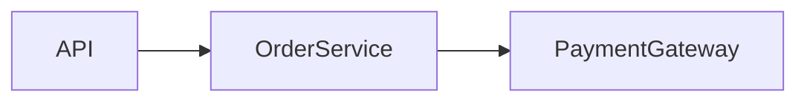

# docdive

Turn Markdown docs with plain Mermaid diagrams into a **system model you can dive into**: click a box to zoom into its
own diagram, and play a feature's flow as an animation across every diagram it crosses.

Three parts:

1. **The model**: plain Mermaid plus YAML frontmatter, so docs keep rendering on GitHub. Remove docdive and nothing breaks.
2. **The viewer**: the `<docdive-diagram>` element (inspector, scenario player, deep dive) and the `<docdive-map>`
   overview, wired into Docusaurus and MkDocs.
3. **The skill**: [`docdive-convert`](packages/docdive/skills/docdive-convert/SKILL.md) has a coding agent convert existing docs into the model.

## Packages

| Package | Registry | What it is |
| --- | --- | --- |
| [`docdive`](packages/docdive) | npm | Indexer and CLI (`build`, `lint`), plus the agent skill |
| [`docdive-element`](packages/docdive-element) | npm | The `<docdive-diagram>` web component |
| [`docusaurus-theme-docdive`](packages/docusaurus-theme-docdive) | npm | Docusaurus adapter |
| [`mkdocs-docdive`](packages/mkdocs-docdive) | PyPI | MkDocs adapter |

Requirements: Node >= 22.12 (also at MkDocs build time), Python >= 3.11 for the MkDocs plugin.

## The model

IDs are the glue: a Mermaid node ID is an element ID, and the same ID in two diagrams is the same element.

````markdown
---
id: system
---

````

A doc with `id: OrderService` and `parent: system` is the zoom into that box (`src` and `description` are optional).
A doc with `kind: scenario` and a `sequenceDiagram` whose participants are element IDs is a flow the viewer animates.
A `Note over OrdersDB: Order id=42 status=paid` after a message is the state that participant holds at that step: the
viewer shows it under the player and in the inspector, step by step, and renders it as a plain note everywhere else.
`src` paths and `entities: { Order: [src/orders/order.ts] }` link boxes and entities to their code: the build copies
the files it finds under the repo root into the site, so a click shows the file right in the page; otherwise the chip
links to the repo (from the site's edit URL on GitHub/GitLab, or an adapter `srcUrl` template).
Full rules: [`conventions.md`](packages/docdive/skills/docdive-convert/references/conventions.md).

Any page can show the whole system with `<docdive-map></docdive-map>`: the element tree and the flows, each linking to
its page.

## Quick start

### Docusaurus

```bash
npm install docusaurus-theme-docdive
```

```js
// docusaurus.config.js
module.exports = {
  markdown: { mermaid: true },
  // docdive must come after theme-mermaid
  themes: ["@docusaurus/theme-mermaid", "docusaurus-theme-docdive"],
};
```

### MkDocs (Material)

```bash
pip install mkdocs-docdive
```

```yaml
# mkdocs.yml
site_url: https://example.com/docs/   # required: diagram links are built from it
markdown_extensions:
  - pymdownx.superfences:
      custom_fences:
        - name: mermaid
          class: mermaid
          format: !!python/name:pymdownx.superfences.fence_code_format
plugins:
  - docdive
```

`mkdocs-docdive` supports MkDocs 1.6 (`mkdocs>=1.6,<2`). MkDocs 2.0 has no plugin system, so it is not supported.

## CLI

```bash
npx docdive lint docs --root .                # model errors, exit 1 when any (--json for warnings)
npx docdive build docs --out build/docdive    # index.json, contexts.json, the element assets and the src/entities files (--root .)
```

Both adapters run `docdive build` after the site build and write into `<site>/docdive/`. Removing the theme or plugin
line brings back the site's native Mermaid.

## Mermaid versions

The element renders with the Mermaid your site already has: an instance the adapter injects (Docusaurus), then a
global `window.mermaid`. If neither exists it lazily loads its own bundled Mermaid 12. It never calls `initialize` on
a host instance. If a host Mermaid produces an SVG whose IDs cannot be mapped, that page falls back to the bundled copy
(`data-docdive-mermaid="bundled-fallback"` on the element).

## Development

```bash
npm install
npm run build
npm run typecheck && npm run lint && npm test && uvx ruff check .
npm run examples:build       # Docusaurus and MkDocs example sites over fixtures/toy (needs uv)
npx playwright install chromium && npm run e2e
```

Release: push a `v*` tag; [`release.yml`](.github/workflows/release.yml) publishes the four packages.

## License

MIT
