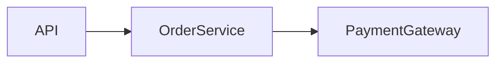

# docdive

Turn a folder of Markdown with plain Mermaid diagrams into a **navigable system model**: click a box to open its
documentation, trace a scenario across diagrams, copy an element's context for a coding agent.

docdive is not a Mermaid fork and not a diagram editor. Docs stay pure Mermaid plus YAML frontmatter, so they keep
rendering on GitHub. Bare `.mmd` files are indexed too, one diagram per file. Remove docdive and nothing breaks.

## Packages

| Package | Registry | What it is |
| --- | --- | --- |
| [`docdive`](packages/docdive) | npm | Indexer and CLI (`docdive`, `ddv`), plus the authoring conventions for agents |
| [`docdive-element`](packages/docdive-element) | npm | The `<docdive-diagram>` web component |
| [`docusaurus-theme-docdive`](packages/docusaurus-theme-docdive) | npm | Docusaurus adapter |
| [`mkdocs-docdive`](packages/mkdocs-docdive) | PyPI | MkDocs adapter |

Requirements: Node >= 22.12 (also at MkDocs build time), Python >= 3.11 for the MkDocs plugin.

## How the docs look

IDs are the glue. A Mermaid node ID is the element ID, and the same ID in two files is the same element.

````markdown
---
id: system
---

````

A file with `id` and `parent: system` in its frontmatter is a deeper zoom of that element, `src:` lists the code that
implements it, and a `sequenceDiagram` file with `kind: scenario` is a scenario whose participants are element IDs.
The full rules, written for agents, are in [`packages/docdive/skill/conventions.md`](packages/docdive/skill/conventions.md).

## Quick start

### Docusaurus

```bash
npm install docusaurus-theme-docdive
```

```js
// docusaurus.config.js
module.exports = {
  markdown: { mermaid: true },
  // docdive must come after theme-mermaid
  themes: ["@docusaurus/theme-mermaid", "docusaurus-theme-docdive"],
};
```

### MkDocs (Material)

```bash
pip install mkdocs-docdive
```

```yaml
# mkdocs.yml
site_url: https://example.com/docs/   # required: diagram links are built from it
markdown_extensions:
  - pymdownx.superfences:
      custom_fences:
        - name: mermaid
          class: mermaid
          format: !!python/name:pymdownx.superfences.fence_code_format
plugins:
  - docdive
```

`mkdocs-docdive` supports MkDocs 1.6 (`mkdocs>=1.6,<2`). MkDocs 2.0 has no plugin system, so it is not supported.

Both adapters run `docdive build` after the site build and write the index, the context bundles and the element
into `<site>/docdive/`. Removing the theme or plugin line brings back the site's native Mermaid.

## CLI

```bash
npx docdive lint --docs docs         # IDs resolve, parents exist, src paths exist (exit 1 on errors)
npx docdive lint --docs docs --fix   # apply the safe fixes
npx docdive init docs                # adoption report for an existing folder
npx docdive index docs --out build   # write build/index.json
npx docdive context OrderService --folder docs   # context bundle to paste into an agent
npx docdive build docs --out build/docdive       # index, contexts and the element assets
npx docdive watch docs --out build/docdive       # build, then refresh index.json and contexts.json on every .md/.mdx/.mmd change
```

`watch` does not reload the browser: serve the output folder with any static server and refresh the page. Ctrl-C stops it
(exit 0); it exits 1 if the docs folder disappears.

Exit codes: `0` ok, `1` errors in the docs or the lint, `2` usage error. Diagnostics go to stderr, data to stdout.

## Mermaid versions

The element renders with the Mermaid your site already has: an instance the adapter injects (Docusaurus), then a
global `window.mermaid`. If neither exists it lazily loads its own bundled Mermaid 12. It never calls `initialize` on
a host instance. If a host Mermaid produces an SVG whose IDs cannot be mapped, that page falls back to the bundled copy
(`data-docdive-mermaid="bundled-fallback"` on the element).

## Development

```bash
npm install
npm run build                # packages, viewer app
npm run typecheck && npm run lint && npm test && uvx ruff check .
npm run examples:build       # Docusaurus and MkDocs example sites (needs uv)
npx playwright install chromium
npm run e2e && npm run e2e:ssg
```

`fixtures/toy` is the sample docs folder used by the examples and the e2e suites. `corpus/` (git-ignored, fetched with
`scripts/fetch-corpus.sh`) holds third-party docs used for the brownfield research in [`docs/`](docs).

## License

MIT
