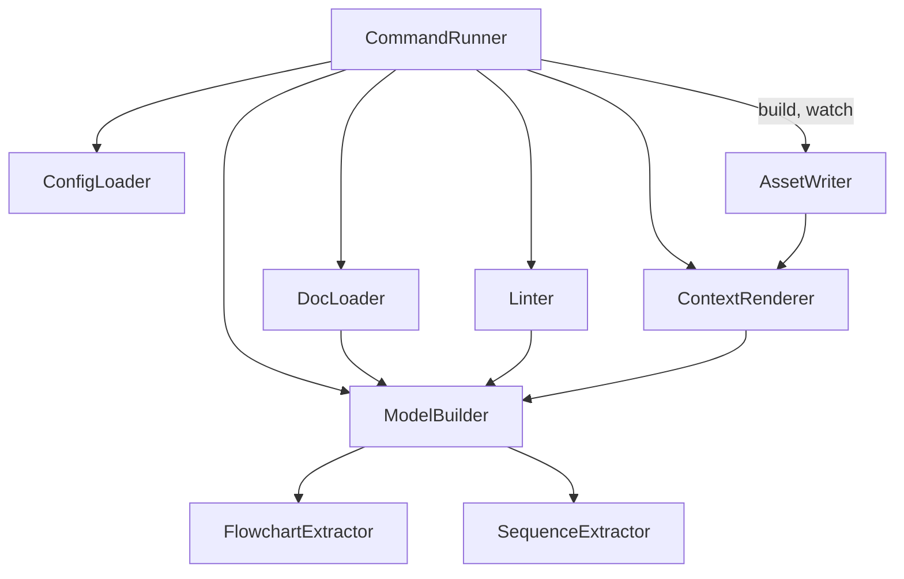

# DocdiveCli

The `docdive` / `ddv` binary. `CommandRunner` parses `index`, `build`, `watch`, `init`, `context`, `stats` and `lint`, with defaults from `docdive.config.json`. `init --agent` prints a prompt that asks an agent to unify near-duplicate element IDs. Exit codes: 0 ok, 1 errors, 2 usage.

- `ConfigLoader` (`config.ts`): reads `docs`, `src`, `out`.
- `DocLoader` (`loader.ts`): walks `.md`/`.mdx`, parses frontmatter and extracts Mermaid fences.
- `ModelBuilder` (`model.ts`): builds `index.json` (elements, diagrams, scenarios, diagnostics) from frontmatter `id`/`parent`/`src` and diagram nodes.
- `FlowchartExtractor` (`flowchart.ts`) and `SequenceExtractor` (`sequence.ts`): turn a fence into nodes, edges and scenario steps.
- `Linter` (`lint.ts`, `fuzzy.ts`, `fix.ts`): `unresolved-participant`, `duplicate-id-siblings`, `missing-parent`, `missing-src`, `fuzzy-id-candidate`; `--fix` renames IDs for `missing-parent` and `fuzzy-id-candidate`. `ModelBuilder` also emits `edge-not-in-diagram`, `duplicate-id-different-labels` and `parse-failed` into `index.json` diagnostics.
- `ContextRenderer` (`context.ts`): per-element Markdown bundle (parent, children, scenarios, src, doc body).
- `AssetWriter` (`run.ts`): writes `index.json` and `contexts.json` atomically and copies the `DocdiveElement` bundle.
