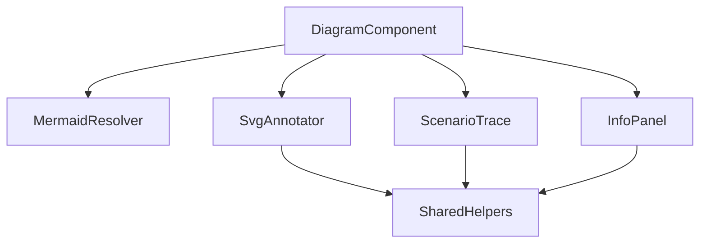

# DocdiveElement

`<docdive-diagram>` renders one Mermaid fence into an open shadow root, maps SVG nodes to IDs through `index.json`, and shows an info panel on click.

- `DiagramComponent` (`element.ts`): lifecycle, JSON loading (`index.json`, `docdive-map.json`, `contexts.json`), click handling.
- `MermaidResolver` (`mermaid-resolver.ts`): host instance from `setMermaid`, then `window.mermaid`, then a lazily bundled copy.
- `SvgAnnotator` (`shared.ts`): tags flowchart nodes and sequence participants with element IDs.
- `InfoPanel`: shows the selected element's fields, a "Copy context" button (text from `contexts.json`), a "Copy link" button (current page URL with `docdive-select` plus the active `docdive-scenario`/`docdive-step`, restored on load) and an "Open" link emitting a cancelable `docdive-navigate` event.
- `ScenarioTrace`: play/pause/step bar, shown when a scenario touches the diagram; state in the `docdive-scenario` and `docdive-step` query params.
- `SharedHelpers` (`shared.ts`): index types, panel fields, trace application.
- Built by esbuild (`scripts/build.mjs`) into `dist/`, which `DocdiveCli` copies at build time.
