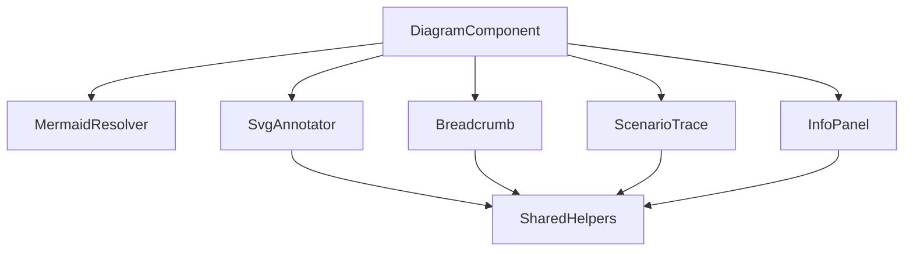

# DocdiveElement

`<docdive-diagram>` renders one Mermaid fence into an open shadow root, maps SVG nodes to IDs through `index.json`, and shows an info panel on click.

- `DiagramComponent` (`element.ts`): lifecycle, JSON loading (`index.json`, `docdive-map.json`, `contexts.json`), click handling.
- `MermaidResolver` (`mermaid-resolver.ts`): host instance from `setMermaid`, then `window.mermaid`, then a lazily bundled copy.
- `SvgAnnotator` (`shared.ts`): tags flowchart nodes and sequence participants with element IDs.
- `InfoPanel`: shows the selected element's fields, a "Copy context" button (text from `contexts.json`), a "Copy link" button (current page URL with `docdive-select` plus the active `docdive-scenario`/`docdive-step`, restored on load) and an "Open" link emitting a cancelable `docdive-navigate` event.
- `Breadcrumb`: `<nav data-docdive-breadcrumb>` above the diagram, root ancestor down to the element owning the page (`data-docdive-crumb="<id>"`, the last one `aria-current="page"`). Ancestors with a mapped URL are links that carry the active trace and emit `docdive-navigate`; others are plain text. Absent when the doc has no owner, several owners or an owner without parent; a parent cycle ends the trail at the first repeat.
- `ScenarioTrace`: play/pause/step bar, shown when a scenario touches the diagram; state in the `docdive-scenario` and `docdive-step` query params.
- `SharedHelpers` (`shared.ts`): index types, panel fields, breadcrumb trail, trace application.
- Built by esbuild (`scripts/build.mjs`) into `dist/`, which `DocdiveCli` copies at build time.

## Theming and motion

- Colors follow the host: `hostTheme` (`shared.ts`) reads Docusaurus `data-theme` and Material `data-md-color-scheme` (`slate` is dark, any other palette light) on `<html>`/`<body>`; a `MutationObserver` mirrors it live onto `data-docdive-theme` on the element. Without a host scheme the element follows `prefers-color-scheme`.
- Override the look with CSS custom properties on `docdive-diagram` (or an ancestor): `--docdive-bg`, `--docdive-border`, `--docdive-accent` (focus ring, links, active step), `--docdive-error`, `--docdive-node-fill`, `--docdive-node-stroke`, `--docdive-edge`, `--docdive-radius`, `--docdive-space`, `--docdive-duration` (hover transitions). The host font is inherited by the chrome; diagram text keeps Mermaid's font because Mermaid measures labels with it.
- Mermaid defaults are restyled by zero-specificity `:where()` rules with `!important` (Mermaid's own `#id` styles would otherwise win). Author `classDef`, `style` and `linkStyle` still take precedence. The host Mermaid instance is never re-initialized.
- The active trace step fades or glows in (nodes, message labels) or redraws (edges, message lines) over 200 ms with the Web Animations API. It is skipped under `prefers-reduced-motion` or when `Element.animate` is missing.
