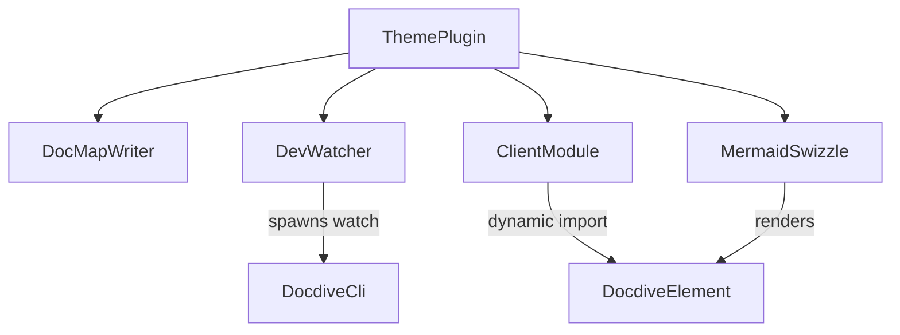

# DocusaurusAdapter

A Docusaurus theme (`docusaurus-theme-docdive`), listed after `@docusaurus/theme-mermaid`. Data only.

- `ThemePlugin` (`index.cjs`): theme hooks; option `src` is the repo root for `src:` paths.
- `DocMapWriter`: writes `docdive-map.json` (doc path to permalink) from `allContentLoaded`.
- `DevWatcher`: under `docusaurus start`, spawns `docdive watch` into the generated dir served by the dev server.
- `ClientModule` (`client.js`): loads `docdive-element.js` and hands it the site's Mermaid via `setMermaid`.
- `MermaidSwizzle` (`theme/Mermaid/index.js`): renders `<docdive-diagram>`; falls back to the native Mermaid component if the bundle fails to load.
