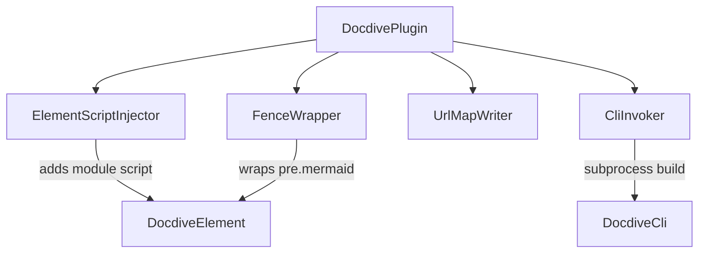

# MkdocsAdapter

The `mkdocs-docdive` plugin. Data only; requires Node >= 22.12 at build time.

- `ElementScriptInjector` (`on_config`): registers `docdive/docdive-element.js` as a module script.
- `FenceWrapper` (`on_page_content`): wraps `<pre class="mermaid">` in `<docdive-diagram>`.
- `UrlMapWriter` (`on_files`, `on_post_build`): collects doc to URL and writes `docdive-map.json`.
- `CliInvoker` (`on_post_build`): runs `docdive build <docs_dir> --out <site_dir>/docdive`; the `command` option pins the CLI version, `src` is the repo root.
