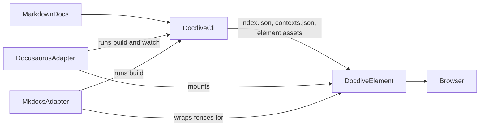

# docdive system

docdive indexes Mermaid diagrams in Markdown docs. `DocdiveCli` builds the model and assets at build time, `DocdiveElement` renders the diagrams in the browser, and the SSG adapters wire both into a documentation site.

- `DocdiveCli`: indexer, linter and context renderer. Holds all product logic.
- `DocdiveElement`: the `<docdive-diagram>` web component.
- `DocusaurusAdapter` and `MkdocsAdapter`: data-only glue; no product logic.
