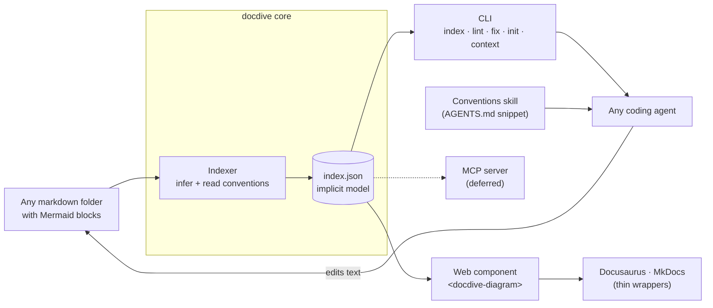
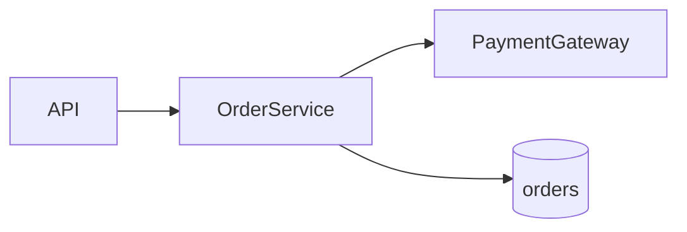
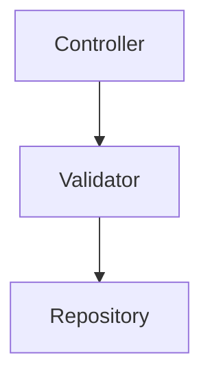
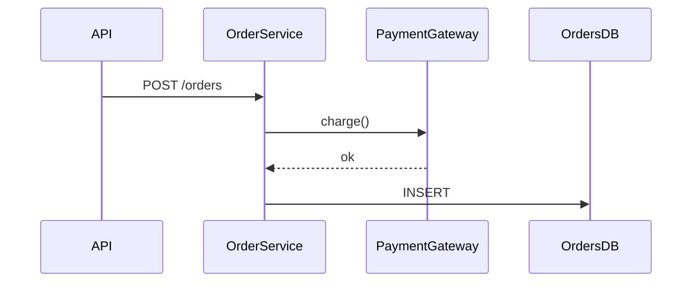

# Product Brief — Dynamic Diagrams for Documentation-as-Code

**Status:** Draft v1 — output of brainstorming session, 2026-11-14
**Name:** `docdive` (CLI `docdive`, alias `ddv`; element `<docdive-diagram>`). Published under that name on npm and PyPI since 0.1.0; the working name `dyd` survives only in older findings documents.
**Owner:** Thibaud Navarre

---

## 1. One-liner

A conventions-and-tooling layer on top of **standard Mermaid** that turns a Markdown documentation folder into a **navigable, explorable system model** — and exposes that model to **coding agents** so a click on a diagram can become a prompt that changes documentation and code.

It is **not** a language, **not** a Mermaid fork, and **not** a diagram editor.

---

## 2. Problem

### 2.1 Context

The owner is building a **Documentation-as-Code** system in which the documentation is the source of truth and the code is generated/updated from it by agents. Diagrams (sequence, flow, component, database model) are the most efficient way to describe how application layers interact — *"a diagram is 10x easier to understand than multi-page text"* — but today's diagrams are:

- **Static pictures.** One file = one view. No way to zoom from a system view into a component's internals.
- **Disconnected.** `OrderService` in the context diagram has no relationship with `OrderService` in the sequence diagram or the ER model. Cross-referencing is done by the reader's memory.
- **Inert for agents.** An agent can *write* Mermaid, but a diagram offers no structured way to say "this box, apply this change" and have the agent resolve what that box *is* (docs, code, scenarios).
- **Not alive.** Documentation evolves continuously under agent edits; the viewer must reflect this without manual steps.

### 2.2 Who has this problem

| Persona | Priority | Need |
|---|---|---|
| **Coding agent** (author) | Primary | Stable identifiers, structured lint feedback, machine-readable context for any element. |
| **Developer** (reader) | Primary | Understand a system fast: deep dive, follow a scenario across diagrams, jump to code. |
| **Architect / tech lead** | Secondary | Same tool at a higher zoom level; cross-layer traceability. |
| **Non-technical stakeholder** | Tertiary | Served by the top-level view only. **Not designed for.** |

### 2.3 Why now

The owner's Doc-as-Code pipeline already keeps docs and code in sync. The missing piece is an interactive, navigable, agent-addressable visualization layer. Without it, the documentation produced by agents is accurate but hard to explore and impossible to manipulate visually.

### 2.4 Jobs to be done

- *When onboarding on an unknown codebase, I want to click through the system from top to bottom so I can build a mental model in minutes instead of days.*
- *When reviewing a feature, I want to select a scenario and watch it light up across the component, sequence and data diagrams so I can verify the design is coherent across layers.*
- *When changing a feature, I want to click the element on a diagram and describe the change so the agent updates documentation and code with the right scope.*
- *As an agent, I want to know whether the diagrams I wrote are consistent (IDs resolve, parents exist, code paths exist) so I can self-correct without a human.*

---

## 3. Key decisions from brainstorming

| # | Decision | Rationale |
|---|---|---|
| D1 | **No fork, no new grammar for v1.** Pure Mermaid + YAML frontmatter + ID conventions. | LLM fluency with Mermaid is the single biggest asset. Any divergence throws away training data. Frontmatter is already parsed/ignored by Mermaid. |
| D2 | **Implicit model by convention.** No central model file; the model emerges from matching stable IDs across diagrams. | Pragmatic, agent-friendly (agents are good at consistent identifiers), zero extra files to keep in sync. |
| D3 | **A sequence diagram *is* a scenario.** Participant IDs are element IDs. | Reuses existing syntax; gives cross-diagram tracing ("distributed trace for documentation") with zero new concepts. |
| D4 | **Viewer is read-only. The diagram is a *selection surface*, not an edit surface.** Click → context → prompt → agent edits text. | Avoids building a visual editor (multi-year scope). Text is already the agent's edit surface. |
| D5 | **`index.json` is the core artifact.** CLI, viewer, MCP are thin consumers. | Unix-tool shape; lets others build consumers; keeps plugins logic-free. |
| D6 | **Agent integration order: CLI → skill/conventions file → MCP.** | CLI is the kernel every agent can call; skill is the authoring contract; MCP is the ergonomic layer, deferred until context needs are known. |
| D7 | **Framework-agnostic web component + `index.json`**, with thin Docusaurus and MkDocs wrappers. | Only architecture that serves a Node and a Python SSG without duplicating logic. |
| D8 | **Progressive enhancement, not migration.** Day 0 works on raw brownfield Mermaid, where "works" means render + `appearsIn` + scenarios + an honest adoption report (no hierarchy inference); conventions improve it; `init` reports the gap and emits an agent prompt to close it. | "Plug and play" and "conventions" are in tension; inference bootstraps, conventions deliver. |
| D9 | **Deletable is a hard constraint.** Remove the tool: docs remain valid Mermaid + valid YAML. | Zero lock-in; kills the fork option for good. |
| D10 | **Live update is a file watcher**, not a design concern. | Struck from language/model design. |
| D11 | **A1 relabelled: "gate passed, assumption not validated".** The pre-registered hub-bundle gate is binding: no re-gate, no re-run, only reinterpretation. The literal 3/3 pass stays on record (`docs/brownfield-findings-2.md`, "Verdict addendum"). | The pass is vacuous on `parent`/`children` (empty on every hub) and the 5 `appearsIn` failures changed no verdict. Changing the gate after seeing the data is not credible. |

---

## 4. Solution overview



Four components, none of which is a language:

1. **Indexer** — scans Markdown, extracts Mermaid blocks + frontmatter, builds the implicit model.
2. **CLI** — `index`, `lint --json [--fix]`, `init [--agent]`, `context <id>`.
3. **Web component** — deep dive, scenario trace, info panel, click-to-source, click-to-context.
4. **Conventions skill** — ~30 lines teaching agents how to write diagrams the tool understands.

---

## 5. The model

### 5.1 Concepts

| Concept | Definition | Source in Markdown |
|---|---|---|
| **Element** | A named thing in the system (service, component, table, actor, module). | Any node ID in a flowchart/graph/C4/class/ER diagram; any participant in a sequence diagram. |
| **Element ID** | Stable identifier shared across all diagrams and docs. Has a **scope** (see §5.3): `global` (default), `local` or `placeholder`. | Mermaid node/participant ID (not the label). |
| **Diagram** | One Mermaid block. Belongs to a document. | Fenced ```` ```mermaid ```` block. |
| **Document** | A Markdown file describing one element or one scenario. | `.md` file with frontmatter. |
| **Parent** | Hierarchical containment used for deep dive. Set only when explicit or unambiguous (§5.3). | `parent:` in frontmatter, or inferred from folder/subgraph when there is exactly one candidate. |
| **Scenario** | An ordered sequence of interactions between elements. | A `sequenceDiagram` whose document has `kind: scenario` (or inferred). |
| **Step** | One message of a scenario. Maps to an edge between two elements. | `A->>B: msg` → edge A→B. |
| **Source link** | Path(s) in the codebase implementing an element. | `src:` in frontmatter, or inferred by symbol search. |

### 5.2 Frontmatter conventions (all optional)

```yaml
---
id: OrderService          # element ID this document describes (default: inferred from filename/H1)
kind: element | scenario  # default: element; scenario if the doc's main diagram is a sequenceDiagram
parent: system            # containing element → enables deep dive
src:                      # code paths implementing the element
  - src/orders/
tags: [domain, backend]   # free
---
```

Mermaid already parses YAML frontmatter at the top of a block (`---\ntitle:\n---`); frontmatter at the **document** level is standard Markdown. Both are valid YAML, ignored by anything that does not know them (D9).

### 5.3 ID rules

- IDs are **unique within a parent**; fully qualified by ancestry when needed (`billing/UserService` vs `identity/UserService`).
- Node **ID** is the identity; node **label** is free text (`OrderService[Order Service]`).
- A participant `OrderService` in a scenario matches element `OrderService`. Unmatched participants are allowed (actors, UI) — they simply do not highlight elsewhere.
- Mermaid `subgraph` = grouping at the same zoom level. A separate document with `parent:` = a deep-dive boundary. (Agents need this rule explicitly; it goes in the skill.)
- **Identity scope.** Every ID has a scope. `global` (default): one element across all diagrams. `placeholder`: IDs of ≤ 2 chars (`A`, `B1`); `local`: the same ID carries conflicting labels across diagrams, or the document declares `ids: local`. Placeholder and local IDs are keyed per diagram and take no part in cross-linking, hubs or hierarchy. A document opts IDs back in with `ids: { shared: [Cache] }`. Keys are optional frontmatter; Mermaid bodies are untouched (D9).
- **Parent resolution.** `parent` is set only when explicit (`parent:` frontmatter) or when exactly one container is a candidate (folder `_index`, a single subgraph, or a doc with an explicit `id:` whose diagrams contain the node). An element with several candidate containers has **no** parent; the candidates are listed in the adoption report. Nodes of a doc whose `id` is only inferred from its filename are **not** its children.
- **SSG frontmatter `id`.** When a Docusaurus or MkDocs config is found at or above the indexed folder, frontmatter `id` is a doc slug (inferred doc id, confidence 0.6), not an element ID.
- **Scenario participants** resolve to a global element only if it has a doc or appears in ≥ 2 diagrams; edge resolution against flowcharts is informational and never a lint error for inferred scenarios.

### 5.4 Example (toy system)

```markdown
<!-- docs/architecture/system.md -->
---
id: system
---


<!-- docs/architecture/order-service.md -->
---
id: OrderService
parent: system
src: [src/orders/]
---


<!-- docs/scenarios/checkout.md -->
---
id: checkout-happy-path
kind: scenario
---

```

From these three plain files the viewer provides: deep dive on `OrderService`, scenario trace lighting up the system diagram step by step, info panel from `order-service.md`, and code link to `src/orders/`.

### 5.5 `index.json` (contract — illustrative shape)

```json
{
  "version": 1,
  "elements": {
    "OrderService": {
      "scope": "global",
      "doc": "docs/architecture/order-service.md",
      "parent": "system",
      "parentCandidates": ["system"],
      "children": ["Controller", "Validator", "Repository"],
      "src": ["src/orders/"],
      "appearsIn": ["docs/architecture/system.md#0", "docs/scenarios/checkout.md#0"],
      "confidence": 1.0
    }
  },
  "diagrams": [
    { "id": "docs/architecture/system.md#0", "type": "flowchart", "nodes": ["API","OrderService","PaymentGateway","OrdersDB"], "edges": [["API","OrderService"],["OrderService","PaymentGateway"],["OrderService","OrdersDB"]] }
  ],
  "scenarios": {
    "checkout-happy-path": {
      "doc": "docs/scenarios/checkout.md",
      "steps": [
        { "from": "API", "to": "OrderService", "label": "POST /orders" },
        { "from": "OrderService", "to": "PaymentGateway", "label": "charge()" }
      ]
    }
  },
  "diagnostics": [
    { "rule": "unresolved-participant", "file": "docs/scenarios/refund.md", "got": "PaymentGW", "suggest": "PaymentGateway", "fix": { "replace": { "PaymentGW": "PaymentGateway" } } }
  ]
}
```

The schema is versioned and public. Everything downstream (viewer, MCP, third parties) depends only on it.

---

## 6. Features

### 6.1 v1 scope (in)

**Indexer / CLI**
- `docdive index` — build `index.json` from a docs folder. Deterministic, fast, no network.
- `docdive lint --json [--fix]` — structured diagnostics with machine-applicable fixes: unresolved participant, duplicate ID across siblings, missing parent, missing `src` path, label/ID near-duplicates.
- `docdive init [--agent]` — brownfield bootstrap. Prints an **adoption report** headlined by identity-class counts (global / local / placeholder) and the top hub bundles, then scenarios detected, conflicts, and a secondary "% cross-linked" line (vocabulary reuse, not model quality). `--agent` emits a single normalization prompt for the user's agent.

*Status:* `--agent` is built for fuzzy ID pairs only (top 20 `edit-distance` pairs, the `lint --fix` step, the conventions). Parents, local IDs, scenario participants and `src` are not in the prompt yet.
- `docdive context <elementId>` — emits the **context bundle**: element doc, parent/children, every diagram it appears in, every scenario passing through it, `src` paths. Markdown and JSON output. `docdive context --all` prints every bundle as a JSON map `{ id: markdown }` (what the SSG adapters publish as `contexts.json`).
- `docdive watch` — re-index on change (live update).

**Inference (brownfield Day 0)**
- Match node IDs across diagrams; fuzzy-match near-duplicates (`OrderSvc` ≈ `OrderService`) with confidence score.
- No hierarchy is promised on brownfield docs: the spike returned no `parent`/`children` on hubs (D11). `parent` is set only when explicit or unambiguous (§5.3).
- Infer scenarios from any existing `sequenceDiagram`.
- Infer info panel content from the nearest Markdown section mentioning the element.
- Infer `src` via simple symbol search (`class OrderService`, `OrderService.ts`, `orders/` folder). Confidence-scored.

**Web component `<docdive-diagram>`**
- Renders standard Mermaid (degrades to plain Mermaid without `index.json`).
- **Deep dive** — click an element that has a child document → navigate/zoom.
- **Scenario trace** — pick a scenario → highlight elements and edges in step order; play / pause / step; works on every diagram the scenario touches.
- **Info panel** — hover/click → element doc excerpt, `src` links, "appears in" list, scenarios through it.
- **Click-to-source** — open the Markdown line defining the element.
- **Click-to-context** — copy the context bundle (or a deep link) for pasting into an agent.
- Breadcrumb for hierarchy; back navigation.

*Status (spike, `docs/trace-context-findings.md`):* the spike element in Docusaurus and MkDocs now has render + ID mapping, info panel, deep dive, scenario trace and click-to-context. A node click selects it and fills the panel. The deep dive is an "Open" link in the panel, which carries scenario + step in the child URL (`docdive-scenario`, `docdive-step`). "Copy context" copies the Markdown bundle, byte-identical to `docdive context <id>`. "Copy link" copies a URL that restores the selection and trace. Pages with several fences work: each diagram traces on its own, and URL state applies to one diagram (`docdive-diagram=<fence>` on copied links; an unqualified link goes to the first matching diagram). Not yet built: click-to-source, breadcrumb/back (the SSG's own navigation stands in).

**Integrations**
- Docusaurus plugin (~40 lines): run `docdive index` at build, inject script + JSON.
- MkDocs (Material) plugin (~40 lines Python): same.
- **Conventions skill** — drop-in `AGENTS.md` / skill snippet covering ID rules, frontmatter keys, subgraph-vs-document rule, scenario authoring, how to read lint output.

### 6.2 Explicitly deferred (not v1)

| Item | Why deferred | Trigger to revisit |
|---|---|---|
| MCP server (`get_element_context`, `trace_scenario`, `lint`) | 200-line wrapper over the CLI; designing it before knowing what agents need would be premature. | CLI `context` output stabilizes after real agent use. |
| Dev-mode agent endpoint in the viewer (click → prompt → agent runs) | Static sites can't call agents; needs a local server mode. | Read-only viewer proves the model. |
| Hierarchical scenarios (a step expanding into sub-steps inside a child) | Pure Mermaid can't express it; ~50% confidence it's needed. | A real diagram that can't be expressed. Likely fix: frontmatter `steps:` with `expands:`. |
| Message IDs (disambiguate two edges between the same pair) | Edge inference from `A->>B` is enough until collisions appear. | Lint detects ambiguous edge mapping in real docs. |
| Visual editing | Replaced by click-to-prompt (D4). | Never, unless D4 is invalidated. |
| Astro / VitePress / other SSG wrappers | Not needed by owner day 1; trivial once web component exists. | Demand. |
| Any Mermaid grammar change | Zero-syntax bet (D1). | Evidence from the toy and brownfield tests. |
| Non-technical stakeholder views | Served by top level for free. | — |

---

## 7. Hard constraints

1. **Text-only source.** Everything is Markdown + Mermaid + YAML. Diffable, reviewable, agent-producible.
2. **Agent-producible.** A coding agent must be able to author compliant diagrams with only the conventions skill (~30 lines) as instruction.
3. **Deletable.** Remove `docdive` and all its plugins: every file remains valid Mermaid + valid YAML and renders on GitHub.
4. **Plug-and-play on brownfield.** Zero-config on an existing docs folder must produce a useful (if partial) model and an honest adoption report. "Useful" means render + `appearsIn` + scenarios + the report; hierarchy (`parent`/`children`) is not promised on brownfield docs (D11).
5. **Weakest-integration-first.** Design for a bare Markdown folder with no frontmatter, no agent, no SSG. If it is useful there, it is useful everywhere.
6. **No product logic in SSG plugins.** Wrappers only run the CLI and inject the component.
7. **Structured, self-fixing lint.** Every diagnostic is JSON with a suggested fix so an agent loop closes without a human.

---

## 8. Assumptions & risks

| # | Assumption | Confidence | How to test cheaply | If wrong |
|---|---|---|---|---|
| A1 | **Brownfield Mermaid is consistent enough for inference to show value on first run.** (Riskiest) | Low (gate passed vacuously; not validated) | Run a ~100-line indexer over the docs of 3 public repos that use Mermaid heavily; inspect the model and adoption report. **Run 1** (≥ 50 % of elements cross-linked by exact ID): failed, best 26.2 %. **Run 2** (pre-registered hub-bundle gate, identity scopes, no first-wins; `docs/brownfield-findings-2.md`): gate passed 3/3 repos, assumption not validated (D11). `parent`/`children` are empty on every hub (they pass by absence), 5 of 15 hubs have mixed `appearsIn`, hubs are generic IDs. A1 spiking is closed. | Day-0 promise reduced to render + `appearsIn` + scenarios + report (D8, D11); fallback lock not triggered. Lean harder on `init --agent` normalization. |
| A2 | Deep dive via `id`/`parent` frontmatter needs no grammar change. | High on the toy (~90% → validated narrowly) | Toy system (§5.4). **Result** (`docs/viewer-findings.md`, pre-registered): deep dive across 3 levels, breadcrumb/back and info panel passed 5/5 headless checks plus the zero-extra-syntax check; owner walkthrough yes. Limits: one 4-doc toy, one author; undocumented elements get `parent` from diagram membership (see `docs/spike-findings.md`), not frontmatter. | Add a frontmatter key, not syntax. |
| A3 | Scenario trace via sequence-diagram participants needs no grammar change. | ~85% (supported on the toy, with a caveat) | Toy system; check edge inference on a diagram with parallel edges. **Result** (`docs/viewer-findings.md`): trace on flowchart (step/play/pause, across diagrams) and on the sequence diagram passed 4/4 headless checks. Parallel edges (`charge()`/`capture()` between the same pair) were highlighted correctly, but only by positional heuristic: it depends on the flowchart declaring edges in the same order as the scenario sends messages, which the index cannot verify. Returns reuse the forward edge (no direction shown). Mermaid's link ids are not `0,1` per pair (`_0`, `_2`). The same heuristic, ported into `<docdive-diagram>`, highlighted the correct edges in Docusaurus and MkDocs too (`docs/trace-context-findings.md`); it is still positional. | Message IDs (deferred item) — warranted if authors cannot keep the two orders aligned. |
| A4 | Agents keep IDs consistent given the conventions skill. | High, validated narrowly (gate passed 3/3; see `docs/agent-findings.md`) | Pre-registered agent test on a real repo (`egoist/tsup`, held-out; skill iterated on `antfu-collective/ni`): 3 fresh isolated agents, gate ≥ 2/3 with 0 gated lint errors after ≤ 1 `--fix` cycle and a non-vacuity floor. **Result: 3/3 passed with 0 errors and 0 cycles at skill v0**; semantic review of the top 5 hubs per run found them consistent (15/15), but one real ID drift (`OptionNormalizer` vs `OptionsNormalizer`) reached only a lint *warning*. Limits: one stack, one model, one repo, a lenient gate, final-reply transcripts only for the leak check, and `--fix` never exercised on agent output. | Strengthen lint `--fix` and `init --agent`. Candidate follow-up: promote `fuzzy-id-candidate` between same-doc-set nodes to an error. |
| A5 | Hierarchical scenarios are rarely needed. | ~50% | Try to document one real multi-layer flow from the owner's project. | Frontmatter `steps:`/`expands:` design. |
| A6 | Click-to-context (copy/deep-link) is a sufficient v1 agent handoff without a live endpoint. | High, validated narrowly (gate passed; see `docs/dogfood-findings.md`) | Pre-registered dogfood on docdive's own architecture: owner clicked an element, pressed "Copy context", and a fresh agent given only the paste plus a one-line task built deep-link copy ("Copy link", `docdive-select`) with code, e2e test and docs. **Result:** right files with no hint, all checks and e2e suites green with zero gap fills, docs lint clean, owner yes. Limits: one change, one agent, one repo, no week-long use; the bundle for a node without its own doc had no `src` and a truncated nearest-section snippet; multi-diagram pages not exercised in a browser. | Prioritize dev-mode endpoint. |
| A7 | Web component + JSON works cleanly inside Docusaurus (React/MDX) and MkDocs (Jinja). | High, validated narrowly (13/13 gate; see `docs/ssg-findings.md`) | Spike: `<docdive-diagram>` + `index.json` on the 4-doc toy in both SSGs. **Result** (pre-registered, static builds under a `/dyd/` base URL): render + ID mapping, deep dive by navigation, info panel (documented and undocumented element) and adapter-removed rendering passed on both, and Docusaurus built without `id:` errors; owner walkthrough yes ("works, but no play/pause": scenario trace was out of scope). Adapters: 55 lines (Docusaurus theme + client module) and 38 (MkDocs `hooks.py`), data only. Findings: Docusaurus uses the toy's `id:` as its doc id (permalinks follow it; a `/` in an id throws); two Mermaid copies per SSG (native 11.x, element 12.3); Material's native path needs unpkg and a closed shadow root, which the element avoids by upgrading before Material mounts; Material/MkDocs 1.x end of life 2027-05-05. Limits: one toy, one fence per page, no dark-mode or client-side-route re-render, production builds only. Scenario trace and click-to-context were added afterwards (`docs/trace-context-findings.md`): 20/20 gate, owner yes. | Fall back to SSG-specific renderers (worse, but possible). |
| A8 | Day-0 output (`appearsIn` bundle on raw brownfield Mermaid, no conventions) helps an agent do a real doc task better than grep alone. | Medium: gate passed, value shown is speed only (`docs/day0-findings.md`) | Pre-registered rename-impact test on a held-out corpus (cloudflare-docs, 201 blocks): 3 elements chosen by a fixed rule, ground truth hand-labeled first, one fresh agent per arm (with / without the `docdive context` bundle). **Result:** both arms 1.00 recall and precision on all 3 elements; arm A 1.5–2.9× faster; no bundle-induced false positive, `Cloudflare`/`cloudflare` kept apart. The bundle itself missed one block on 2 of 3 elements (parse-failed bidirectional arrows); both agents verified and recovered. Limits: ties make the recall gate vacuous, one model, one task family, one run per cell. | Keep D8's wording: Day-0 is a shortcut, not a source of truth. If a later task-based test shows no speed gain either, drop `appearsIn` from the Day-0 promise and lead with `init --agent`. |

---

## 9. Success criteria (v1)

- **Toy test:** on the 3-file toy system, deep dive + scenario trace + info panel work with zero non-Mermaid syntax beyond frontmatter. *"Does clicking `OrderService` and selecting `checkout-happy-path` feel like understanding the system?"* — qualitative yes. Result (`docs/viewer-findings.md`): passed. Toy extended to 3 levels and a parallel-edge case; 10/10 pre-registered headless checks and owner yes (weakly reasoned: "Good"). Limits: one toy, one author, gate written by the viewer's builder.
- **Brownfield test:** on 3 public repos, `docdive init` runs without configuration and prints identity-class counts and hub bundles. Gate (pre-registered, `docs/brownfield-findings-2.md`): for the top 5 global hubs per repo (≥ 3-char IDs, by diagram count), a bundle passes at ≥ 3 of 4 binary fields (`appearsIn` only lists diagrams where the ID means this concept; `parent` absent or a real container; `children` without placeholders/doc slugs; `scenarios` involve the element); a repo passes on a majority of its hubs; the gate passes on ≥ 1 repo. Non-concept hubs count against it. The old "≥ 50 % cross-linked" metric is reported for comparison only. Result: gate passed, assumption not validated (vacuous on `parent`/`children`; see §8 A1 and D11).
- **Agent test:** an agent given only the conventions skill produces a 5-document system that passes `docdive lint` with zero errors after at most one `--fix` cycle. Result (`docs/agent-findings.md`): 3/3 fresh agents on a held-out real repo (tsup) produced 8–10 documents with zero errors and no `--fix` cycle; passed, with the limits listed in §8 A4.
- **Deletability test:** remove the tool; all docs render on GitHub unchanged.
- **Integration test:** the same `index.json` + component renders in Docusaurus and MkDocs with wrappers under ~50 lines each. Result (`docs/ssg-findings.md`): passed 13/13 headless checks plus owner yes; wrappers are 55 lines (Docusaurus, three files) and 38 (MkDocs), so "~50" holds roughly. Follow-up (`docs/trace-context-findings.md`): scenario trace (flowchart and sequence, carried across deep dive) and "Copy context" passed 18/18 checks on the two SSGs, the A7 and viewer suites stayed green, and the owner said yes ("Seems ok"). Wrappers grew by 2 lines (Docusaurus) and 7 lines (MkDocs), still data only.
- **Day-0 value test (A8):** on a held-out brownfield corpus, a fresh agent given the `docdive context` bundle finds the diagrams affected by a rename at least as completely as a grep-only agent, with no bundle-induced false positive. Result (`docs/day0-findings.md`): passed as ties (1.00/1.00 both arms on 3 elements), bundle arm 1.5–2.9× faster; the bundle missed one parse-failed block on 2 of 3 elements and the agents recovered it. Supports "shortcut", not "source of truth".
- **Dogfood:** the owner's Doc-as-Code pipeline uses `docdive context` as agent input for at least one real change end-to-end (diagram click → prompt → doc + code updated). Result (`docs/dogfood-findings.md`): passed. docdive's own architecture docs, one change (deep-link copy) built by a fresh agent from the pasted context alone, 3/3 pre-registered items and owner yes; limits in §8 A6.

---

## 10. Validation plan (before the viewer)

1. **Week 1 — Toy + indexer spike.** Hand-write 4–5 Mermaid docs for a fake system. Write a throwaway indexer (~300 lines) that extracts frontmatter + IDs, builds `index.json`, prints `context OrderService`. Prototype scenario highlighting on one flowchart.
   *Decision gate:* does the implicit model hold with zero new syntax? Record anything inexpressible.
2. **Week 1 — Brownfield spike (A1).** Point the indexer at 3 public repos. Inspect inferred model quality. Draft the adoption report format from what is actually found.
3. **Week 2 — Conventions skill + agent test (A4).** Write the ~30-line skill; have an agent generate docs for a small real repo; run lint; iterate the skill until clean. *Done: skill v0 (34 lines) was clean on the dev repo without revision and passed the held-out gate 3/3; see `docs/agent-findings.md`.*
4. **Done — Viewer spike (toy test):** throwaway page (deep dive, scenario trace, info panel) passed the pre-registered toy test; see `docs/viewer-findings.md`.
4b. **Done — SSG spike (A7):** `<docdive-diagram>` extracted from the viewer and embedded in Docusaurus 3.10.2 and MkDocs Material 9.8.1; passed the pre-registered checklist; see `docs/ssg-findings.md`.
4c. **Done — trace + click-to-context in the element:** scenario trace (state carried across deep dive in the URL) and "Copy context" in both SSGs; passed the pre-registered checklist; see `docs/trace-context-findings.md`.
5. **Then** — web component packaging (the element has trace, click-to-context, deep-link copy and multi-fence pages; click-to-source still to add), CLI hardening (e.g. an index output path so builds do not rewrite the corpus). Dogfood (A6) is done; see `docs/dogfood-findings.md`. Open from the spike: message IDs vs positional edge mapping (A3), sequence features not exercised (self-messages, `alt`/`loop`, notes), bundle size.

---

## 11. Open questions

- **Naming:** **Resolved:** `docdive`, published on npm (`docdive`, `docdive-element`, `docusaurus-theme-docdive`) and PyPI (`mkdocs-docdive`). The conventions skill ships inside the `docdive` package.
- **Tech stack:** **Resolved** as recommended: TypeScript core (`packages/docdive`, Node ≥ 22.12) and a data-only Python shim for MkDocs that shells out to `npx docdive@<version>` (`packages/mkdocs-docdive`).
- **Mermaid parsing:** **Resolved** as recommended: hand-written extractors for flowchart (`flowchart.ts`, including subgraphs) and sequence (`sequence.ts`) feed the index; `mermaid` itself runs only in the browser, for rendering. Blocks of other types are counted as `unsupported-type` in the adoption report, blocks the extractor cannot read as `parse-failed`.
- **ID qualification syntax:** `billing/UserService` vs `billing.UserService` — Mermaid node IDs restrict characters; validate which separator survives in all supported diagram types. The A7 spike adds a constraint: Docusaurus rejects a `/` in a doc `id:` (see `docs/ssg-findings.md`), so `/` cannot be used if `id:` doubles as a doc id there.
- **Where does the context bundle's "nearest Markdown section" end?** **Resolved:** the matching list item (with its continuation lines) or, for prose, the matching paragraph, capped at about 400 characters and cut at a word boundary with `…`. When the element has no doc or `src` of its own, the bundle also carries the nearest ancestor's doc path and declared `src` (labeled `inherited from`) and the inferred `src`.
- **Ranking of `init --agent` pairs:** top 20 by confidence is dominated by same-file clusters (temporal: 15/20 are `*PRIM` region codes from one file; gitlabhq: 11/20 are `BulkImports::*Worker{A,B,BB}` from `bulk_import.md`). Two IDs that only ever appear in the same diagram are rarely one concept. **Tested and rejected (2026-11-16, [ranking-findings.md](./ranking-findings.md)):** down-ranking same-file and instance-suffix pairs removed the noise from the top 20 but surfaced no extra real merge (temporal 1 vs 1, gitlabhq 1 vs 1, posthog 3 vs 3 on a blind labeling), so it was not shipped. Still open: the corpora hold very few real merges and pair precision stays low; a better signal than ordering (e.g. label similarity, shared neighbours) is untested.
- **Diagram types in scope for v1:** **Decided:** flowchart/graph and sequenceDiagram only (shipped in 0.1.0–0.3.0). erDiagram, classDiagram and C4 are not indexed; they render as plain Mermaid and are counted as `unsupported-type`. ER was dropped from the v1 recommendation because it is rare in the brownfield corpora (gitlabhq: 4 files with `erDiagram` and 4 with `classDiagram` against 119 with flowcharts; posthog and temporal: none); add a type when a real repo needs it, not before.

---

## 12. What this is not (positioning guardrails)

- Not a Mermaid fork or alternative language (vs. D2, Structurizr DSL, PlantUML). *Steal ideas from D2 `layers`/`steps`; do not adopt.*
- Not a diagram editor (vs. Excalidraw, draw.io, tldraw).
- Not an architecture-model platform (vs. Structurizr, IcePanel). No central model file, no server, no accounts.
- Not an AI that "understands" diagrams. Inference bootstraps adoption; conventions deliver the experience.

**Positioning in one phrase:** *Conventional Commits, for diagrams.*
